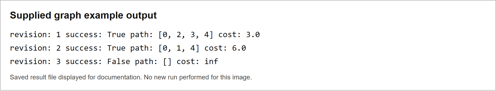
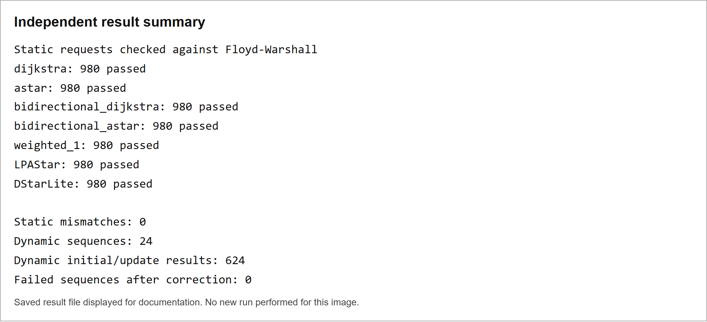

# M4 Global Planner

Development process and verification

We receive a complete weighted graph from the planning-map generation task. Our job is to find the minimum-cost route through it, including any supplied WALK-to-FLY or FLY-to-WALK transitions. We do not generate nodes or edges, check robot collision geometry, or calculate edge prices again.

The production planner uses A* with a safe distance estimate. Dijkstra remains available as an exact reference and fallback. Both return the same minimum cost in the current tests. A* is a working default, not a claim that it is fastest in every environment.

```text
Planning map generation: nodes + valid edges + costs + revision
  -> Global planner: check -> search -> route/cost audit
  -> Local planner/controller: execution
```

### What is working

Graph validation, directed path search, cost checks, graph replacement, changed-start requests and stale-result checks are implemented. The package has 59 passing tests. Independent checks cover 6,860 static requests and 624 initial/update results. The example changes route correctly when supplied prices or connections change.

### What is still open

The real producer message, controller route message, action references, update ordering and operational time/memory targets are not integrated. This is a tested graph-search prototype, not a fully validated autonomous navigation system.

The report separates current code, saved benchmarks, independent checks and remaining work. Synthetic graph tests are not robot simulation.

## 1 Responsibility and architecture

| Part | Responsibility |
| --- | --- |
| Planning-map generation | Supply complete nodes, valid directed movement/transition edges and costs. Own motion feasibility, clearance and graph coverage. |
| Global planner | Validate the supplied structure, choose the lowest-cost complete route, audit its edges/cost, and search replacement snapshots. |
| Local planning and control | Interpret actions, track motion, handle immediate avoidance and coordinate stopping or replacing a running route. |

A transition is an edge, not a third mode. One search chooses WALK sections, FLY sections and transition locations together. It does not optimize WALK and FLY separately and then join unrelated routes.

### Why the project changed

The earlier implementation also created graphs from test maps. It included Hybrid WALK connections, lattice and roadmap alternatives, FLY sampling, transition generation and map adapters. Once the team confirmed a complete graph handoff, those implementations duplicated another task. They were removed from active source and preserved outside the project for handover.

Removal does not mean every method failed. Some passed useful tests; others missed connections. Those are graph-generation findings. The global planner cannot recover a physical connection absent from its input graph.

### Testing boundary

Graph fixtures are created only as test inputs standing in for upstream output. Production search never calls a sampler, map adapter, collision validator or motion connector. A lazy graph builder is rejected by the wrapper.

| Observation | Owner of investigation |
| --- | --- |
| A graph route exists but search misses it or returns a higher cost | Global search or input conversion. |
| A physically possible route is absent from the graph | Planning-map graph coverage or connection rules. |
| A supplied edge is physically unsafe | Upstream motion validation. |
| The chosen route is not followed correctly | Controller/action integration. |

## 2 Input output and graph updates

The API accepts a Python Graph object. This is an internal interface; the final team message format is not yet agreed.

| Field | Current rule |
| --- | --- |
| Node | Integer ID. Coordinates, mode and heading are optional. Supplied coordinates must be complete and finite; heading must be finite. |
| Directed edge | Existing endpoints and finite nonnegative cost. One edge per ordered pair. Self-edges are rejected. |
| Mode metadata | WALK/FLY labels identify mode changes when both are present. Missing labels permit abstract search, but do not supply executable mode actions. |
| Revision | Nonempty string or integer. A complete new snapshot replaces the previous one. |
| Start and goal | Existing node IDs. No automatic pose snapping or connection generation. |
| Result | Success/no-path, ordered nodes/edges, mode-changing edges, total cost, revision, snapshot ID and work/time counters. |

A successful route is checked against the accepted directed edges, and its total is recomputed. No-path has an empty path and infinite cost. Identical start and goal return one node at zero cost. Invalid input raises an error rather than pretending no route exists.

### Update process

Inputs are copied so caller edits cannot change an accepted snapshot. Each replacement invalidates earlier results through an internal counter, even if the external revision label is reused. A rejected update disables the old graph. Replanning uses the replacement and current start ID; it does not rebuild a map.

Updates are synchronous. Revision labels are not ordered. Cancellation, out-of-order-message rejection and controller acknowledgement are not implemented. Freshness checking applies within the planner instance that produced the result.

### Interface gaps

The final contract needs coordinate frame, cost units, action IDs and path payload references. Endpoint-pair edge identity cannot represent two different actions between the same nodes. Extend that interface if the producer needs parallel edges.

## 3 A route example and its output

Nodes 0, 1 and 4 are WALK; 2 and 3 are FLY. The fixture contains only these five directed edges:

| Edge | Meaning in the fixture | Cost |
| --- | --- | --- |
| 0 -> 1 | WALK movement | 3 |
| 1 -> 4 | WALK movement | 3 |
| 0 -> 2 | WALK-to-FLY transition | 1 |
| 2 -> 3 | FLY movement | 1 |
| 3 -> 4 | FLY-to-WALK transition | 1 |

The all-WALK route costs 6. The mixed route costs 3, so it is selected. Raising edge 2->3 to 10 makes the mixed route cost 12; WALK at cost 6 is then selected. Removing 1->4 and 2->3 blocks both alternatives, producing no-path.

Figure 1. Screenshot of the saved example output, displayed from its result file. This is not a live robot run.



### Meaning of the result

This checks whole-route selection across modes, supplied cost changes and disconnection. It does not establish physical transition feasibility. Costs are test values, not calibrated seconds or energy.

## 4 Search methods and selection rules

| Method | Reason for testing | Current decision |
| --- | --- | --- |
| Dijkstra | Exact, geometry-independent search. | Reference and selectable fallback. |
| A* with h = 0 | Control with no distance guidance. | Automatic safe fallback. |
| Safe A* | Exact guided search. | Production default, with workload limits. |
| Weighted A* | Measure speed versus higher cost. | Evaluation only; not strict minimum cost. |
| Bidirectional Dijkstra | Search forward and backward. | Evaluation only; reverse-index setup was costly. |
| Bidirectional A* | Two directions with safe reweighting. | Evaluation only; preparation outweighed expansion savings. |
| LPA* | Reuse forward state after updates. | Evaluation only; no measured advantage on the tested update family. |
| D* Lite | Reuse backward state; move start. | Evaluation only; zero-cost update fallback is explicit. |

The selection order is correctness, represented-route success, minimum cost, then time and memory. We do not combine everything into one weighted score or select a method from one small timing difference.

A* is not always faster. Its benefit depends on how much positions and prices tell it about remaining cost. Weak guidance can make Dijkstra faster. No automatic switch based on benchmark labels is implemented.

### Research basis

A* uses accumulated cost plus a lower bound on remaining cost. A consistent lower bound supports exact graph search. Incremental methods reuse search information after changes; that explains why they were evaluated, but does not guarantee they are faster here.

Theory sources: Russell and Norvig, AIMA informed search material, aima.cs.berkeley.edu/slides-pdf/chapter04a.pdf; Koenig and Likhachev, D* Lite, AAAI proceedings, publications.ri.cmu.edu/d-lite. Measured project findings are separate from these principles.

## 5 Costs and measurement formulas

Route cost is the sum of supplied edge costs. Distance, terrain, reverse, pivot and transition penalties are not added again by global search.

```python
C(route) = sum(cost(u, v) for each selected edge)
alpha = min(cost(u, v) / distance(u, v))  # positive distances
h(node) = alpha * distance(node, goal)
f(node) = reached_cost(node) + h(node)
```

Each edge costs at least alpha times its endpoint distance. Straight-line distance therefore gives a lower bound on any route to the goal. Missing/unusable geometry, no positive-distance edge or a zero-cost movement gives h=0. Numerical range and cost-unit limits still need agreement.

| Metric | Calculation or meaning |
| --- | --- |
| Reachability and validity | Correct success/no-path; correct endpoints; directed edges exist; reported cost matches its sum. |
| Optimality ratio | C / Cref when Cref > 0. Equal zero costs give ratio 1. No-path has no meaningful ratio. |
| Extra cost percent | 100 x (C / Cref - 1), where the ratio is defined. |
| Mean and median | Mean = sum(t)/n. Median is the middle sorted value, or mean of the two middle values. |
| Sample standard deviation | sqrt(sum((t - mean)^2)/(n - 1)). Min/max give the observed range. |
| Speedup | Reference time / candidate time. Above 1 means faster within that timing boundary. |
| Expansion reduction | 100 x (reference expanded - candidate expanded) / reference expanded. |
| Memory | Earlier small-fixture probe: peak Python allocations. Not RSS or whole-system live memory. |

The audit tolerance is configurable and applies to absolute/relative numerical comparison. It is not permission to select a more expensive route. Fewer turns and geometric path length are not separate objectives unless supplied costs encode them.

### Recorded metric inventory and availability

| Metric | Static / weighted evidence | Dynamic evidence | Interpretation and availability |
| --- | --- | --- | --- |
| Success and route validity | `success`, `path_valid` in summary; success and independently checked route in every timed static row. | Both fields are recorded per update and in each summary row. | Endpoint, supplied-edge membership and recomputed cost are checked; invalid results fail the campaign. |
| Route size and cost | `path_state_count`, `path_cost`, `dijkstra_reference_cost`, `optimality_ratio`, `suboptimality_pct`. | Replanned cost and updated Dijkstra reference, ratio and suboptimality per update. | Zero-reference-cost ratios follow the documented zero-cost convention; no-path has no meaningful ratio. |
| Search work | `expanded_nodes`, `generated_nodes`, `processed_nodes`, `edge_evaluations`. | Median expanded nodes and fresh-A* expanded nodes in the summary; generated nodes and edge evaluations per update in raw runs. | Algorithm-local counts are not perfectly interchangeable. Incremental edge evaluations omit some scans in repair/path recovery; generated nodes may include retained state. No separate edge-relaxation counter was recorded. |
| Runtime distribution | Per algorithm/scenario: median, mean, sample standard deviation, minimum and maximum over 10 timed runs. Raw runtime for each run is retained. | Per-update summary: median, mean, sample standard deviation, minimum and maximum of total update-to-route time over five sequence repetitions. Update-processing and replan medians are separate; all component times are in raw runs. | Timings use `time.perf_counter_ns()`. Median is the primary comparison. |
| Graph and request | Scenario, purpose, `|V|`, `|E|`, start, goal, WALK/FLY node counts, algorithm, weight and heuristic. | Dynamic fixture identity, update number/type/edge, fixed start/goal and graph size in the manifest. | Edges are directed; counts and edge costs describe the exact supplied fixture. |
| Memory | Peak `tracemalloc` Python allocation for all eight configurations on `small_static_grid` only; blank for other scenarios. Graph-input allocation is excluded. | Not measured. | Not process RSS, total resident memory or a large-graph memory ceiling. |
| Update/reuse performance | Not applicable. | Initialization, initial-plan median, update-processing median, replanning median, total update-to-route distribution, speedup vs fresh A*, and expansion reduction vs fresh A*. | Speedup is fresh-A* median total time divided by candidate median total time; below 1 means the candidate is slower. |
| Scalability | Not stored as one metric; inferred by comparing the same algorithms across the four grid sizes. | Not independently varied by graph size. | The dynamic sequence uses one 901-node graph and one fixed start. |
| Physical or producer costs | Not measured or recomputed. | Not measured or recomputed. | The planner consumes supplied edge weights; graph generation and physical-cost assignment are upstream responsibilities. |

The aggregate static and weighted CSV files preserve the complete per-scenario field values; their raw companions preserve every individual timing sample. The dynamic aggregate and raw CSVs preserve all update summaries and observations. Where a requested metric is unavailable (system RSS, physical feasibility, separate relaxation count, or dynamic memory), it is reported as unavailable rather than inferred.

The saved-outcome audit found no invalid rows: all 80 static results and 40 weighted results pass route validation, including eight and four expected unreachable outcomes respectively (empty path, infinite cost, and `path_valid: true`); all 12 dynamic summaries are successful and valid.

## 6 Timing boundaries and fair comparison

| Measurement | Included | Excluded |
| --- | --- | --- |
| Earlier static search | One algorithm call; some methods also prepare their own reverse index or search state. | Fixture creation, wrapper validation/copy, reference search, route audit and file output. |
| Earlier update test | Edge edit plus replanning on an existing graph. | Full snapshot receipt/validation, transport and controller action. |
| New wrapper check | Snapshot acceptance, search, result assembly and route audit, recorded separately. | Fixture creation, imports, independent verification, output and controller latency. |

The earlier safe-A* scale was prepared before its timer. Bidirectional A*, LPA* and D* Lite checked the scale inside their timed call. These are implementation-call comparisons with different preparation costs, not proof that one search principle is always faster.

Earlier static tests used ten repetitions in fixed order, with no warm-up. The additional wrapper check used seven repetitions with alternating method order. Small differences can include scheduling, allocation and cache effects. We have no real-time target yet.

Incremental edge-evaluation counters do not include every scan inside vertex repair or path recovery. Generated-node counters can include retained history. They must not be read as identical units of work across all methods.

The saved benchmark manifest does not bind the original run to source hashes. An earlier independent review recorded source hashes, but subsequent route-audit tests and the audited-cost return change mean those hashes do not identify the current source. Six hundred static and weighted summary statistics were checked against raw samples; their arithmetic matches. This is not a rerun of those benchmarks.

Native Windows, Python 3.12. The final test interpreter reported 3.12.14. No cross-platform or hardware-normalized performance claim is made. Earlier incremental timing rows predate the zero-cost correction described below.

## 7 Supplied-graph test environments

| Fixture | Purpose | `|V|` | `|E|` | Start | Goal | WALK / FLY nodes |
| --- | --- | ---: | ---: | ---: | ---: | ---: |
| small_static_grid | Open 12 x 12 grid; small baseline. | 144 | 1,012 | 0 | 143 | 144 / 0 |
| medium_static_grid | Open 40 x 40 grid; scale. | 1,600 | 12,324 | 0 | 1,599 | 1,600 / 0 |
| large_static_grid | Open 100 x 100 grid; scale. | 10,000 | 78,804 | 0 | 9,999 | 10,000 / 0 |
| very_large_static_grid | Open 200 x 200 grid; scale. | 40,000 | 317,604 | 0 | 39,999 | 40,000 / 0 |
| walk_only_grid | Open 30 x 30 WALK grid. | 900 | 6,844 | 0 | 899 | 900 / 0 |
| multimodal_supplied_graph | Five-node WALK/FLY choice with supplied transitions. | 5 | 5 | 0 | 4 | 3 / 2 |
| weighted_astar_tradeoff | Cost-12 corridor versus attractive cost-15 route. | 1,004 | 1,004 | 0 | 1,003 | 1,004 / 0 |
| unreachable_goal | 40 x 40 grid disconnected by a complete vertical cut. | 1,600 | 12,088 | 0 | 1,599 | 1,600 / 0 |
| narrow_constrained_route | Long narrow corridor with dead-end branches. | 599 | 1,196 | 0 | 299 | 599 / 0 |
| multiple_alternative_costs | 60 x 60 grid with a localized expensive crossing patch. | 3,600 | 28,084 | 0 | 3,599 | 3,600 / 0 |
| dynamic_two_corridor_graph | Short primary and longer alternate route under four sequential edits. | 901 | 1,802 | 0 | 300 | 901 / 0 |

These are graph environments; they do not test robot collision or terrain physics. The alternative-cost patch is localized and lies away from the direct diagonal, so this fixture checks pricing without forcing a route change. The small multimodal example does force route choice to respond to supplied costs. The dynamic request uses a fixed start and applies every listed update to both directed arcs of the edge pair.

The open grids have eight-direction connections, geometric costs and opposite-corner requests. They strongly favor distance guidance. They do not represent clutter. The expensive patch in the alternative-cost fixture lies away from its direct diagonal, so that case does not force a changed route. The small multimodal example does force a route change when its prices change.

A narrow graph corridor is also not proof that a physical robot fits a narrow passage. Upstream must validate that before supplying its edges.

## 8 Saved algorithm comparison

There are 800 static samples: ten fixtures, eight configurations, ten repetitions. Every reported exact reachable result matched Dijkstra cost; disconnected requests returned no path. The table shows saved median call times in milliseconds. Complete aggregate and raw fields for all ten fixtures are retained in `benchmark_results/`.

| Method | 144 nodes | 1,600 | 10,000 | 40,000 |
| --- | --- | --- | --- | --- |
| dijkstra | 0.1444 | 1.8595 | 16.0293 | 68.3353 |
| astar_h0 | 0.1749 | 2.5387 | 18.5949 | 88.8568 |
| astar_safe | 0.0320 | 0.1230 | 0.3296 | 0.6507 |
| bidirectional_dijkstra | 0.2883 | 4.6223 | 64.8577 | 279.4092 |
| bidirectional_astar | 0.4080 | 5.4695 | 60.9496 | 291.4536 |
| lpa_star | 0.5966 | 5.7768 | 36.1015 | 147.7005 |
| d_star_lite | 0.8215 | 5.1741 | 34.8765 | 144.9735 |

#### Detailed scalability counters and timing spread

For every row below, success and path validation were true, the reported path cost matched the Dijkstra reference within audit tolerance, the optimality ratio was 1, and suboptimality was 0%. `Generated / processed / edge eval.` are algorithm-local counters. Each timing distribution is from 10 runs. The exact graph-specific Dijkstra reference costs are listed first; complete values for all ten fixtures are in `benchmark_results/benchmark_static.csv`.

| Grid (`|V|` / `|E|`) | Dijkstra reference cost |
| --- | ---: |
| small (144 / 1,012) | 15.55634918610405 |
| medium (1,600 / 12,324) | 55.154328932550676 |
| large (10,000 / 78,804) | 140.00714267493635 |
| very large (40,000 / 317,604) | 281.428498912247 |

| Grid | Algorithm | Path states | Path cost | Expanded | Generated | Processed | Edge eval. | Median ms | Mean ± sample SD ms | Min–max ms |
| --- | --- | ---: | ---: | ---: | ---: | ---: | ---: | ---: | ---: | ---: |
| small | Dijkstra | 12 | 15.55634918610405 | 144 | 144 | 144 | 1,009 | 0.14445 | 0.14574 ± 0.00449 | 0.1415–0.1566 |
| small | A*, h=0 | 12 | 15.55634918610405 | 144 | 144 | 144 | 1,009 | 0.17485 | 0.17812 ± 0.00864 | 0.1729–0.2015 |
| small | A*, safe | 12 | 15.55634918610405 | 12 | 54 | 12 | 83 | 0.03200 | 0.03421 ± 0.00547 | 0.0316–0.0491 |
| small | Weighted A*, w=1 | 12 | 15.55634918610405 | 12 | 54 | 12 | 83 | 0.06825 | 0.07277 ± 0.01223 | 0.0625–0.0998 |
| small | Bidirectional Dijkstra | 12 | 15.556349186104047 | 100 | 124 | 100 | 706 | 0.28825 | 0.30483 ± 0.03854 | 0.2811–0.3999 |
| small | Bidirectional A* | 12 | 15.556349186104047 | 11 | 52 | 11 | 78 | 0.40800 | 0.41329 ± 0.01428 | 0.4062–0.4531 |
| small | LPA* | 12 | 15.55634918610405 | 12 | 54 | 12 | 86 | 0.59660 | 0.67320 ± 0.19072 | 0.5664–1.1963 |
| small | D* Lite | 12 | 15.55634918610405 | 12 | 54 | 12 | 86 | 0.82150 | 0.79335 ± 0.23427 | 0.5249–1.2549 |
| medium | Dijkstra | 40 | 55.154328932550676 | 1,600 | 1,600 | 1,600 | 12,321 | 1.85945 | 1.98752 ± 0.35437 | 1.7974–2.9756 |
| medium | A*, h=0 | 40 | 55.154328932550676 | 1,600 | 1,600 | 1,600 | 12,321 | 2.53875 | 2.72264 ± 0.51121 | 2.2650–3.7764 |
| medium | A*, safe | 40 | 55.154328932550676 | 40 | 194 | 40 | 307 | 0.12300 | 0.12684 ± 0.00943 | 0.1214–0.1517 |
| medium | Weighted A*, w=1 | 40 | 55.154328932550676 | 40 | 194 | 40 | 307 | 0.11805 | 0.11989 ± 0.00492 | 0.1150–0.1314 |
| medium | Bidirectional Dijkstra | 40 | 55.15432893255071 | 1,130 | 1,234 | 1,130 | 8,706 | 4.62225 | 4.97724 ± 0.83887 | 4.2145–6.5322 |
| medium | Bidirectional A* | 40 | 55.15432893255071 | 39 | 192 | 39 | 302 | 5.46945 | 10.73347 ± 14.95351 | 5.0478–53.1424 |
| medium | LPA* | 40 | 55.154328932550676 | 40 | 194 | 40 | 310 | 5.77685 | 6.00583 ± 0.92911 | 4.9206–7.3263 |
| medium | D* Lite | 40 | 55.154328932550676 | 40 | 194 | 40 | 310 | 5.17405 | 5.33962 ± 0.63800 | 4.6680–6.6206 |
| large | Dijkstra | 100 | 140.00714267493635 | 10,000 | 10,000 | 10,000 | 78,801 | 16.02930 | 16.08587 ± 0.65781 | 15.1779–17.4831 |
| large | A*, h=0 | 100 | 140.00714267493635 | 10,000 | 10,000 | 10,000 | 78,801 | 18.59490 | 19.03953 ± 1.37044 | 18.0192–22.6243 |
| large | A*, safe | 100 | 140.00714267493635 | 100 | 494 | 100 | 787 | 0.32955 | 0.40858 ± 0.14265 | 0.3084–0.7066 |
| large | Weighted A*, w=1 | 100 | 140.00714267493635 | 100 | 494 | 100 | 787 | 0.29650 | 0.29906 ± 0.00665 | 0.2941–0.3167 |
| large | Bidirectional Dijkstra | 100 | 140.00714267493643 | 7,070 | 7,344 | 7,070 | 55,716 | 64.85775 | 64.67499 ± 26.29223 | 37.2393–93.6627 |
| large | Bidirectional A* | 100 | 140.00714267493643 | 99 | 492 | 99 | 782 | 60.94965 | 66.60895 ± 28.75502 | 38.1443–103.9856 |
| large | LPA* | 100 | 140.00714267493635 | 100 | 494 | 100 | 790 | 36.10150 | 36.61693 ± 1.72464 | 34.8260–38.9751 |
| large | D* Lite | 100 | 140.00714267493635 | 100 | 494 | 100 | 790 | 34.87650 | 38.64025 ± 12.23997 | 33.1437–73.2318 |
| very large | Dijkstra | 200 | 281.428498912247 | 40,000 | 40,000 | 40,000 | 317,601 | 68.33525 | 68.60637 ± 2.75045 | 62.2581–72.4872 |
| very large | A*, h=0 | 200 | 281.428498912247 | 40,000 | 40,000 | 40,000 | 317,601 | 88.85675 | 89.53198 ± 3.42791 | 83.8286–95.8490 |
| very large | A*, safe | 200 | 281.428498912247 | 200 | 994 | 200 | 1,587 | 0.65070 | 0.70539 ± 0.15127 | 0.6382–1.1246 |
| very large | Weighted A*, w=1 | 200 | 281.428498912247 | 200 | 994 | 200 | 1,587 | 0.69845 | 0.84041 ± 0.34736 | 0.6366–1.7678 |
| very large | Bidirectional Dijkstra | 200 | 281.4284989122459 | 28,282 | 28,838 | 28,282 | 224,566 | 279.40925 | 272.51942 ± 25.52408 | 215.1064–305.8892 |
| very large | Bidirectional A* | 200 | 281.4284989122459 | 199 | 992 | 199 | 1,582 | 291.45355 | 280.37025 ± 32.19136 | 221.7002–308.5573 |
| very large | LPA* | 200 | 281.428498912247 | 200 | 994 | 200 | 1,590 | 147.70050 | 161.70243 ± 34.59362 | 140.0305–249.1339 |
| very large | D* Lite | 200 | 281.428498912247 | 200 | 994 | 200 | 1,590 | 144.97350 | 156.00566 ± 26.46314 | 137.4918–208.5010 |

The only static memory values are the small-grid `tracemalloc` peaks: Dijkstra 28,392 bytes; A*, `h=0` 37,640; safe A* 14,224; Weighted A*, `w=1` 13,496; bidirectional Dijkstra 115,976; bidirectional A* 100,944; LPA* 136,648; D* Lite 136,696. They exclude the graph and are not RSS. No memory ranking for larger graphs is supported.

The runner supports runtime-versus-size, expansions-versus-size, path-quality, dynamic-runtime and Weighted A* runtime/degradation figures. No plots were emitted because matplotlib is not installed in the selected environment (`plots_generated: false` in the manifest); the numerical CSV/JSON outputs remain the benchmark evidence.

On the 40,000-node open grid, safe A* expanded 200 nodes versus 40,000 for Dijkstra. Its recorded search call was about 105 times faster. That number excludes the full wrapper and comes from favorable geometry. It is not a whole-planner or general-environment speedup.

### Weighted A* tradeoff

All four rows below succeeded and passed route validation. The Dijkstra reference cost is 11.99999999999981; every row has 10 measured runs. This table includes the full recorded counters and timing spread for the constructed 1,004-node tradeoff case.

| Weight | Path states | Expanded | Generated | Processed | Edge eval. | Median ms | Mean ± sample SD ms | Min–max ms | Path cost / reference | Ratio | Extra cost % |
| ---: | ---: | ---: | ---: | ---: | ---: | ---: | ---: | ---: | ---: | ---: | ---: |
| 1.00 | 1,003 | 1,003 | 1,004 | 1,003 | 1,003 | 0.68555 | 0.68228 ± 0.07033 | 0.6022–0.7648 | 12 / 12 | 1.000 | 0.00 |
| 1.25 | 1,003 | 1,003 | 1,004 | 1,003 | 1,003 | 0.62685 | 0.62496 ± 0.01077 | 0.6129–0.6471 | 12 / 12 | 1.000 | 0.00 |
| 1.50 | 3 | 3 | 4 | 3 | 3 | 0.00280 | 0.00328 ± 0.00132 | 0.0025–0.0068 | 15 / 12 | 1.250 | 25.00 |
| 2.00 | 3 | 3 | 4 | 3 | 3 | 0.00260 | 0.00277 ± 0.00053 | 0.0024–0.0042 | 15 / 12 | 1.250 | 25.00 |

Weights 1.5 and 2 found cost 15 instead of 12. That is a deliberate speed-quality tradeoff, not minimum-cost planning. Weighted A* therefore remains outside the production API. A faster answer with higher cost does not meet our current exact-search requirement.

## 9 Updates and a confirmed failure

The saved update campaign repeated four changes five times. These medians cover edge modification plus search on an existing graph; they do not cover replacement-snapshot handling.

| Update | Fresh A* ms | LPA* ms | D* Lite ms | Cost |
| --- | --- | --- | --- | --- |
| 1 block_edge | 0.6662 | 2.1888 | 2.0136 | 601.0 |
| 2 increase_edge_cost | 0.6357 | 3.9220 | 1.9188 | 612.0 |
| 3 reopen_edge | 0.5171 | 0.7467 | 0.6211 | 300.0 |
| 4 block_edge | 0.6303 | 1.0508 | 0.9602 | 612.0 |

Fresh A* was faster on this family. This does not rule out incremental methods for other graphs or update patterns. They remain evaluation code, not production update handling.

### Complete repeated-update comparison

The fixture is the 901-node/1,802-edge WALK graph with start 0 and goal 300. Each edge update changes both directed arcs. Initialization and initial-plan timings are included to show reuse cost, but speedup compares only fresh-A* total update-to-route median with the candidate's total update-to-route median. Generated-node and edge-evaluation medians below are recalculated from the five raw observations per row. Every result succeeded, passed route validation, and matched the updated Dijkstra cost (ratio 1.0, suboptimality 0%).

| # | Update / edge pair | Algorithm | Init ms | Initial plan median ms | Update median ms | Replan median ms | Total median ms | Total mean ± sample SD ms | Min–max ms | Expanded / fresh | Generated | Edge eval. | Expansion reduction % | Speedup vs fresh A* | Cost / Dijkstra |
| ---: | --- | --- | ---: | ---: | ---: | ---: | ---: | ---: | ---: | ---: | ---: | ---: | ---: | ---: | ---: |
| 1 | block 150↔151 | Fresh A* | 0.0000 | 0.5514 | 0.0025 | 0.6644 | 0.6662 | 0.83210 ± 0.32028 | 0.6249–1.3847 | 752 / 752 | 752 | 1,501 | 0.00 | 1.000 | 601 / 601 |
| 1 | block 150↔151 | LPA* | 1.1259 | 2.2895 | 0.0122 | 2.1781 | 2.1888 | 2.30054 ± 0.27355 | 2.1149–2.7797 | 467 / 752 | 901 | 933 | 37.90 | 0.304 | 601 / 601 |
| 1 | block 150↔151 | D* Lite | 1.4086 | 2.2637 | 0.0102 | 2.0039 | 2.0136 | 2.05122 ± 0.08964 | 1.9759–2.2046 | 468 / 752 | 901 | 935 | 37.77 | 0.331 | 601 / 601 |
| 2 | increase 500↔501 cost to 12 | Fresh A* | 0.0000 | 0.5514 | 0.0083 | 0.6271 | 0.6357 | 0.73044 ± 0.22132 | 0.6193–1.1261 | 752 / 752 | 752 | 1,501 | 0.00 | 1.000 | 612 / 612 |
| 2 | increase 500↔501 cost to 12 | LPA* | 1.1259 | 2.2895 | 0.0140 | 3.9022 | 3.9220 | 4.49582 ± 0.92026 | 3.8117–5.8116 | 802 / 752 | 901 | 1,604 | -6.65 | 0.162 | 612 / 612 |
| 2 | increase 500↔501 cost to 12 | D* Lite | 1.4086 | 2.2637 | 0.0127 | 1.9059 | 1.9188 | 2.02322 ± 0.23798 | 1.9018–2.4484 | 402 / 752 | 901 | 804 | 46.54 | 0.331 | 612 / 612 |
| 3 | reopen 150↔151 at cost 1 | Fresh A* | 0.0000 | 0.5514 | 0.0054 | 0.5124 | 0.5171 | 0.56176 ± 0.08125 | 0.4837–0.6792 | 573 / 573 | 574 | 1,144 | 0.00 | 1.000 | 300 / 300 |
| 3 | reopen 150↔151 at cost 1 | LPA* | 1.1259 | 2.2895 | 0.0108 | 0.7368 | 0.7467 | 0.75378 ± 0.03294 | 0.7277–0.8079 | 150 / 573 | 901 | 300 | 73.82 | 0.693 | 300 / 300 |
| 3 | reopen 150↔151 at cost 1 | D* Lite | 1.4086 | 2.2637 | 0.0106 | 0.6105 | 0.6211 | 0.69652 ± 0.11407 | 0.6140–0.8660 | 151 / 573 | 901 | 302 | 73.65 | 0.833 | 300 / 300 |
| 4 | block 151↔152 | Fresh A* | 0.0000 | 0.5514 | 0.0018 | 0.6284 | 0.6303 | 0.63180 ± 0.01707 | 0.6148–0.6529 | 753 / 753 | 753 | 1,503 | 0.00 | 1.000 | 612 / 612 |
| 4 | block 151↔152 | LPA* | 1.1259 | 2.2895 | 0.0072 | 1.0417 | 1.0508 | 1.06918 ± 0.04381 | 1.0243–1.1321 | 150 / 753 | 901 | 299 | 80.08 | 0.600 | 612 / 612 |
| 4 | block 151↔152 | D* Lite | 1.4086 | 2.2637 | 0.0072 | 0.9534 | 0.9602 | 1.20976 ± 0.55094 | 0.9339–2.1942 | 153 / 753 | 901 | 305 | 79.68 | 0.656 | 612 / 612 |

The five repetitions exercised the complete sequence, not just isolated single edits. Incremental methods reduced expansions on most updates, but did not beat fresh A* in total update-to-route time on any of these four updates. Initialization is not included in the speedup ratio, so including one-time setup would make these incremental end-to-end comparisons less favorable still. Raw observations include each run's route state count and exact cost audit.

### Zero-cost cycle: failure, reason and correction

```python
0 -> 1 : 1     1 -> 2 : 0
2 -> 1 : 0     2 -> 3 : 1
0 -> 3 : 5
```

The initial best cost is 2. Removing 0->1 caused LPA* to retain stale cycle information and fail during route recovery. Removing 2->3 exposed the same class of problem in D* Lite. The valid replacement route has cost 5. Fresh A* and Dijkstra were not affected.

The smallest safe prototype correction is a full reset when an update affects a graph containing zero-cost edges before or after the edit. The result labels this as full_reset_zero_cost. It does not claim incremental speed for that update. Positive-cost repair remains incremental.

Four added regression tests cover both algorithms and both removals, followed by reopening the edge: costs 2, 5, then 2. All pass. Earlier timing rows remain saved observations from before this correction; no broad timing campaign was repeated.

## 10 Independent correctness checks

| Check | Size | Result |
| --- | --- | --- |
| Static directed graphs | 20 seeds x 49 endpoint pairs x 7 methods = 6,860 requests. | All match independent Floyd-Warshall costs and route checks. |
| Update and moving-start checks | 24 workers x 2 methods x 13 initial/update results = 624. | All pass after the zero-cost correction. |
| Saved summary arithmetic | 600 median/mean/SD/min/max values. | Match static and weighted raw CSV samples. |
| Full current package suite | 59 tests. | 59 passed; no failures or skips; captured in `evidence/global_planner/independent_review/latest_final_suite.txt`. |
| Supplied-graph example | Initial route, changed costs, then disconnection. | Costs 3, 6, then no path. |

The static cases include directed edges, arbitrary coordinates, mixed mode labels and costs 0, 0.25, 1, 3 and 9. Floyd-Warshall uses a different recurrence from the heap searches, reducing the risk of sharing the same search mistake.

Update cases cover positive and zero costs, removals, additions and cost changes. D* Lite start positions also change. Four-second worker limits distinguish a hang from a returned no-path result. No worker timed out after the correction.

Saved independent-check output. These are graph requests and update results, not thousands of separate physical robot environments.



The initial failure is retained beside corrected evidence. Passing bounded tests does not prove every possible numeric input or future producer graph.

## 11 Additional wrapper measurements

Seventy calls were measured: five inputs, two production methods, seven repeats. Both methods used identical graphs and endpoints. Route costs were checked independently. Graph acceptance and route auditing were included in the total.

| Input | Purpose | `|V|` | `|E|` | Start | Goal | WALK / FLY nodes |
| --- | --- | ---: | ---: | ---: | ---: | ---: |
| open_grid | Favorable distance-guidance control. | 1,600 | 12,324 | 0 | 1,599 | 1,600 / 0 |
| alternating_barriers | Three graph cuts with alternating permitted crossing rows; forces a detour. | 1,600 | 11,622 | 0 | 1,599 | 1,600 / 0 |
| coordinates_omitted | Same open connectivity, no coordinate guidance. | 1,600 | 12,324 | 0 | 1,599 | 1,600 / 0 |
| zero_cost_guidance | A zero-cost movement reduces the safe global scale to zero. | 1,600 | 12,324 | 0 | 1,599 | 1,600 / 0 |
| directed_mixed_modes | Arbitrary-geometry directed graph with mixed mode labels. | 300 | 1,191 | 0 | 299 | 200 / 100 |

| Input | Method | Search ms | Total ms | Expanded |
| --- | --- | --- | --- | --- |
| open_grid | dijkstra | 2.108 | 24.591 | 1600 |
| open_grid | astar | 0.189 | 18.373 | 40 |
| alternating_barriers | dijkstra | 1.521 | 19.530 | 1330 |
| alternating_barriers | astar | 3.053 | 29.948 | 1131 |
| coordinates_omitted | dijkstra | 1.965 | 15.318 | 1600 |
| coordinates_omitted | astar | 2.446 | 15.491 | 1600 |
| zero_cost_guidance | dijkstra | 2.088 | 21.953 | 1600 |
| zero_cost_guidance | astar | 2.625 | 19.415 | 1600 |
| directed_mixed_modes | dijkstra | 0.006 | 1.668 | 3 |
| directed_mixed_modes | astar | 0.010 | 1.661 | 3 |

A* helped on the open grid. Dijkstra was faster on the alternating barriers even though A* expanded fewer nodes. Missing coordinates and zero-cost guidance remove its main advantage. Tiny mixed-mode differences are too small to drive selection.

These saved timings predate the final route-audit hardening. The post-change wrapper verifier passed on the same scenarios, but its temporary timings were discarded; rerun and save that campaign before making current-source wrapper performance claims.

The larger acceptance times include graph validation, copying and scale preparation. Total-time variation must not be mistaken for a search improvement. Complete mean, standard deviation and range are in `evidence/global_planner/independent_review/paired_summary.csv`; raw repetitions are in `evidence/global_planner/independent_review/paired_raw.csv`.

We retain safe A* as the current default and Dijkstra as an explicit fallback. We have evidence for both. We do not claim a universal winner or add an untested automatic selector.

## 12 Current test coverage: input and route

This matrix groups distinct behaviours. It is not a count of individual pytest parameter combinations. All listed checks passed in the current suite or independent checks.

| Case | Required result |
| --- | --- |
| WALK-only graph | Return the cheapest supplied WALK route. |
| Mixed WALK/FLY graph | Choose the full route including supplied transitions. |
| Expensive transition route | Choose the cheaper alternative; do not prefer flight by name. |
| Directed connections | Never use the reverse of an edge unless supplied. |
| Disconnected goal | Return no path, not a fabricated link. |
| Start equals goal | One-node path; zero cost. |
| Alternative routes | Choose minimum supplied total, not fewest edges. |
| Zero-cost edges and cycles | Return a valid minimum-cost route without looping. |
| Missing coordinates | Use zero heuristic; keep exact search. |
| Arbitrary coordinates/prices | Keep heuristic safe; do not treat distance as cost. |
| Missing mode metadata | Allow abstract search without inventing mode changes. |
| Malformed node/edge records | Reject invalid structure. |
| Negative, NaN or infinite cost | Reject before search. |
| Missing edge endpoint | Reject graph rather than silently drop the edge. |
| Partial or nonfinite coordinates | Reject invalid coordinate input. |
| Lazy builder supplied as graph | Reject; graph generation is outside this API. |
| Large finite path costs | Preserve finite multi-edge sums in the supported float range. |

## 13 Current test coverage: updates and audit

| Case | Required result |
| --- | --- |
| Caller changes original graph | Accepted snapshot remains isolated. |
| New graph revision | Plan from the replacement snapshot. |
| Cost-only update | Recompute choice and cost. |
| Previously useful edge removed | Use another route or return no path. |
| Previously blocked connection restored | Allow the route again. |
| Bad replacement graph | Do not silently continue with stale planning state. |
| Old route after replacement | Reject as stale. |
| Reused external revision label | Internal snapshot identity still distinguishes results. |
| Route with wrong edge or cost | Audit rejects mismatch. |
| Configured audit tolerance | Accepts only within the chosen tolerance and returns the recomputed edge sum. |
| Changed start request | Search from the new existing node. |
| Incremental zero-cost cycle edit | Explicit reset; no stale success/failure. |
| Heuristic weakened by new price | Keep exactness after update. |
| Weighted higher-cost result | Measure the gap; do not label it optimal. |
| Independent reference | Match Floyd-Warshall on bounded directed graphs. |

The archived image displays the earlier 54-test independent-review run, before the final route-audit and large-cost regressions were added. The final pre-commit suite was rerun after those changes.


The current 59-test result is separately captured in `evidence/global_planner/independent_review/latest_final_suite.txt`; the 54-test screenshot above is retained as historical evidence and does not represent the latest suite.

## 14 Decisions and development history

| Stage, newest first | What changed and why |
| --- | --- |
| Independent review | Found stale zero-cycle labels in evaluation-only incremental search. Added explicit full-reset fallback and four regressions. Added wrapper-level timing and independent graph checks. |
| Broader search evaluation | Compared exact, weighted, bidirectional and incremental methods on supplied graphs. Selected safe A* as the working default, kept Dijkstra, and left other methods outside production. |
| Complete-graph boundary agreed | Removed active node/edge generation, geometric validation and map adapters. They belong to planning-map generation. Retained graph-input validation, exact search, route audits and replacement snapshots. |
| Earlier joint geometric prototype | Combined WALK/FLY/morph graphs and compared search on those constructed graphs. Useful historical work, but it also owned graph generation. |
| Earlier WALK and FLY comparisons | Compared Hybrid, lattice and roadmap choices. Some roadmap samples/connections missed passages and interior turns; lattice could find specific witnesses. These are representation findings, not search failures on a complete supplied graph. |

The older graph-generation suite recorded 347 passes and 61 failures before scope cleanup. Those failures were not repaired by deleting their tests. Their original evidence and removed source were archived for recovery and handover. The current 59-test suite covers a smaller, different responsibility.

Old physical-space benchmark counts are not added to current graph-search counts. Changes in scope, code, inputs or timing boundaries prevent treating them as one continuous speed ranking.

### Method-by-method selection evidence

| Method | Measured evidence | Selection rationale |
| --- | --- | --- |
| Dijkstra | Exact and geometry-independent. On the 40,000-node grid it expanded 40,000 nodes and took 68.33525 ms median. | Retained as the correctness reference and selectable fallback. It is not the default on these geometry-aligned grids because safe A* found the same cost with far fewer expansions and lower median time. |
| A*, `h=0` | Matched Dijkstra cost and expanded the same number of nodes, but was slower at every tested grid size (88.85675 ms vs 68.33525 ms on 40,000 nodes). | Not the preferred configuration when safe guidance exists. The production wrapper uses zero guidance when the safe heuristic cannot be established, preserving exactness. |
| Safe A* | On 40,000 nodes: 200 expansions, 0.65070 ms median, cost 281.428498912247, ratio 1. | Selected for initial planning in the current prototype; measured benefit is strongest on geometric graphs and is not assumed universal. |
| Weighted A* | On the crafted graph, `w=1.5` and `w=2` reduced expansions from 1,003 to 3 and median time from 0.68555 ms to 0.00280/0.00260 ms, but returned cost 15 vs 12 (25% extra). | Not selected as an automatic or production mode because the observed speed gain sacrifices the minimum-cost requirement. |
| Bidirectional Dijkstra | On 40,000 nodes: 28,282 expansions, but 279.40925 ms median; reverse-graph preparation is included in the call. | Not selected because lower expansions did not offset per-query setup and runtime in this implementation. |
| Bidirectional A* | On 40,000 nodes: 199 expansions versus safe A*'s 200, but 291.45355 ms median versus 0.65070 ms. | Not selected; the measured implementation's potential/reverse preparation dominates the small expansion reduction. |
| LPA* | Initial 40,000-node plan: 147.70050 ms. In the four dynamic updates, it was slower end-to-end than fresh A* each time; update 2 expanded 802 vs 752 fresh-A* nodes. | Not selected for replanning on this workload. Its retained state reduced expansions on three updates but did not pay for repair/setup overhead. Zero-cost-cycle updates require `full_reset_zero_cost`. |
| D* Lite | Initial 40,000-node plan: 144.97350 ms. In the four dynamic updates, it was slower end-to-end than fresh A* each time, despite lower expansions. | Not selected for replanning on this workload. Its moving-start capability remains useful for future workloads, but was not the measured advantage here; zero-cost-cycle updates require `full_reset_zero_cost`. |

The incremental initial-plan timings include per-instance search-state construction, while dynamic initialization is reported separately and excluded from the total-update-to-route speedup. The conclusion is limited to the tested implementation, graph family and timing boundary.

### Why alternatives were not selected

Weighted A* can return higher cost. Bidirectional methods paid preparation costs in the measured implementation. LPA* and D* Lite did not beat fresh A* on the tested update family and need a safe reset for zero-cost updates. Roadmap, lattice and Hybrid generate or connect planning states; selecting them is now upstream work, not another production search option here.

We retain experiments that explain a decision, including failures. We do not keep every tested algorithm in the production API. Future changes should follow a concrete failed requirement and a measured replacement, not a new algorithm name alone.

## 15 Important files and repeatable checks

| File | Purpose |
| --- | --- |
| src/m4_global_planner/m4_global_planner/graph.py | Supplied node/edge data and graph structure. |
| src/m4_global_planner/m4_global_planner/astar.py | Production A* and Dijkstra. |
| src/m4_global_planner/m4_global_planner/global_planner.py | Snapshot checks, selection, route audit and updates. |
| src/m4_global_planner/m4_global_planner/benchmark_algorithms.py | Evaluation-only alternatives; separate from production. |
| src/m4_global_planner/test/ | Input, search, update and regression tests. |
| examples/supplied_graph_demo.py | Small readable route/cost/update example. |
| benchmarks/ | Synthetic graph fixtures and repeated timing runner. |
| benchmark_results/ | Saved original CSV samples, summaries and manifest. |
| evidence/global_planner/independent_review/ | Independent checks, paired timing, logs, hashes and report screenshots. |
| GLOBAL_SEARCH.md | Current technical report and source of truth. |

### Commands from the project folder

```python
.venv\Scripts\python.exe -m pytest -q
.venv\Scripts\python.exe examples\supplied_graph_demo.py
```

Benchmark reruns need a fresh output directory and a recorded source version. Do not overwrite the evidence used for the current decision. Preserve raw samples so mean, median and spread can be recalculated.

The five-node example is the clearest first demonstration: inspect graph input, run the example, then show the path changing after price and connectivity changes. The output image earlier in this report records exactly that behaviour.

## 16 Completion and remaining work

| Acceptance item | Status and next evidence |
| --- | --- |
| Search supplied directed graphs exactly | Passed current tests. A*/Dijkstra remain production choices. |
| Validate and isolate graph snapshots | Implemented and tested; final message conversion remains open. |
| Audit route and total cost | Implemented and tested. |
| Handle replacement snapshots | Implemented. Real transport ordering and concurrent execution are not integrated. |
| Compare algorithms fairly | Bounded synthetic comparison plus independent checks completed. Real workload and latency/memory limits remain open. |
| Producer agreement | Agree IDs, revisions, costs/units, coordinates, optional mode labels, transition/action references and supported numeric ranges. |
| Controller agreement | Agree route payload, cancellation, stale-route rejection and acknowledgement. |
| Real supplied graphs | Replay representative upstream snapshots, including cluttered connectivity, sparse/dense graphs, weak guidance and updates. |
| Operational acceptance | Measure input-to-route time and live memory against agreed limits on target hardware. |
| Robot validation | Upstream feasibility and downstream execution tests are still required; graph-search tests cannot replace them. |

We can commit the verified software checkpoint after reviewing the intended staged files and confirming no further edits are in progress. That commit records a tested supplied-graph prototype, not completion of real-robot navigation. No commit or push was performed during this review.

When real inputs arrive, conversion should stay at the input boundary. Search should not need robot dimensions or terrain rules: those affect supplied validity and costs upstream. A different cost objective, parallel action edges, asynchronous updates or controller requirements may require explicit interface changes.

The next engineering task is the producer/controller contract and a small end-to-end replay using that contract. Further algorithm work is justified only by a failed correctness requirement or a measured operational limit.

Evidence boundaries: current package 59 passing tests; independent static requests 6,860; corrected initial/update results 624; additional paired wrapper calls 70. Historical benchmark timings remain separately labelled. No physical execution or universal performance guarantee is claimed.
